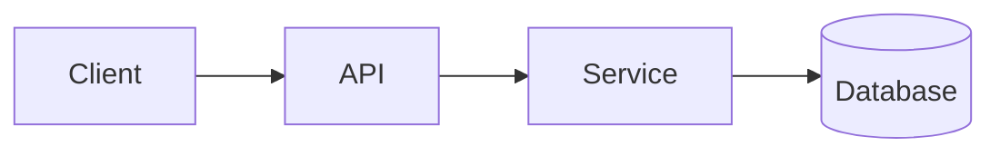

# Code Analysis Report Template

**Use when:** the agent is documenting how an existing codebase actually works — its structure, dependencies, data flow, and risks. The reader is onboarding, planning a change, or assessing whether the system can absorb a new requirement.

**Do not use for:** reviewing a pending change (use `code-review-report.md`).

---

## Template

```markdown
# Code Analysis: <system or module name>

| Field | Value |
|---|---|
| Author | <name or agent> |
| Date | <YYYY-MM-DD> |
| Version | <v1.0> |
| Status | Draft / In Review / Final |
| Subject | <repository, service, or module analyzed> |
| Revision analyzed | <commit SHA, tag, or branch> |
| Analysis method | <static reading / execution / tracing / profiling> |
| Scope | <what was analyzed> |
| Out of scope | <what was not analyzed> |

## Executive summary

<3–6 sentences. What this system is, how it is put together, and the
one or two things a reader most needs to know before changing it.>

## 1. Purpose and scope of the system

<What the system does, from the outside. Its users, its entry points,
its boundaries.>

## 2. Architecture overview

### 2.1 Component map

<ASCII or Mermaid diagram. Show the major components and the direction
of data and control flow. Label every edge.>



### 2.2 Component inventory

| Component | Path | Responsibility | Depends on | Owned by |
|---|---|---|---|---|

### 2.3 Entry points

| Entry point | Type | Trigger | Auth | Notes |
|---|---|---|---|---|

## 3. Module breakdown

### 3.1 <Module name>

| Field | Value |
|---|---|
| Path | |
| Responsibility | |
| Public interface | |
| Depends on | |
| Depended on by | |

<Describe the module's role, its key abstractions, and any invariant it
maintains.>

### 3.2 <Module name>

## 4. Control flow

### 4.1 Primary flow
<The main path through the system, step by step, with the entry and exit
points marked.>

### 4.2 Sequence: <operation>
<Step-by-step trace of one representative operation. Number the steps.
Name the functions.>

| Step | Location | Action | State touched |
|---|---|---|---|

### 4.3 Error and edge-case paths
<What happens on failure at each stage. Where exceptions are caught and
translated. What is retried.>

## 5. Data model and storage

### 5.1 Entities

| Entity | Store | Key | Owner module | Retention |
|---|---|---|---|---|

### 5.2 Relationships
<Diagram or description.>

### 5.3 Schema or table detail
<For each significant table or collection: fields, types, constraints,
indexes.>

### 5.4 Data lifecycle
<How data is created, updated, versioned, expired, and deleted.>

## 6. External dependencies

| Dependency | Kind | Version | Used for | Failure impact | Optional? |
|---|---|---|---|---|---|

## 7. Configuration and environment

| Variable | Required | Default | Effect | Secret? |
|---|---|---|---|---|

## 8. Cross-cutting concerns

### 8.1 Error handling
<Conventions, exception hierarchy, retry policy, user-facing messages.>

### 8.2 Concurrency and state
<Threading, async, locking, shared mutable state, idempotency.>

### 8.3 Observability
<Logging, metrics, traces, run IDs. What is emitted and where.>

### 8.4 Security and privacy
<AuthN/AuthZ, secret handling, PII handling, masking, tenancy enforcement.>

### 8.5 Testing
<What test layers exist, what they cover, what is untested.>

## 9. Risks and technical debt

| ID | Risk | Likelihood | Impact | Evidence | Mitigation |
|---|---|---|---|---|---|

## 10. Findings

<Observations that are not defects but are worth knowing: surprising
behavior, implicit coupling, undocumented invariants, performance
characteristics.>

## 11. Recommendations

| # | Recommendation | Rationale | Effort | Risk of change |
|---|---|---|---|---|

## 12. Limitations and open questions

<What was not analyzed, what could not be determined statically, what
needs runtime verification.>

## Appendix A: File inventory

| Path | Lines | Purpose |
|---|---|---|

## Appendix B: Dependency graph

## Appendix C: Glossary
```

---

## Rules for writing analysis

1. **Describe what is, not what should be.** This document reports the system as it exists. Recommendations live in section 11 and are clearly separated.
2. **Anchor every claim to a location.** `path/to/file.py:142`, a config key, a log line. A claim with no anchor is a guess.
3. **Distinguish observed from inferred.** If you read the code and inferred the behavior, say "inferred from the call at X". If you ran it, say "observed at runtime".
4. **Record the revision.** Code analysis is a snapshot. Without a commit SHA the document is unverifiable.
5. **Note the analysis method.** Static reading and runtime tracing surface different things, and the reader needs to know which you did.
6. **Document the implicit.** The most valuable content in a code analysis is the invariant that is enforced nowhere but that everything depends on.
7. **Do not guess at intent.** If a piece of code looks wrong, describe what it does and flag it as a question. Do not assert the author's intent.
